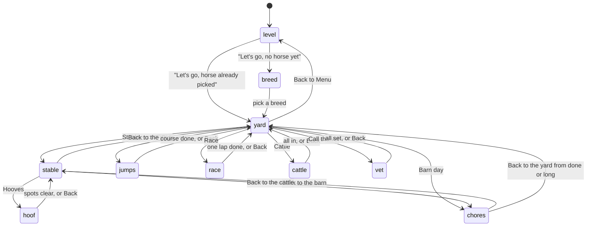
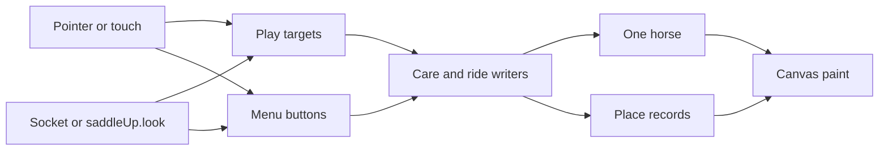
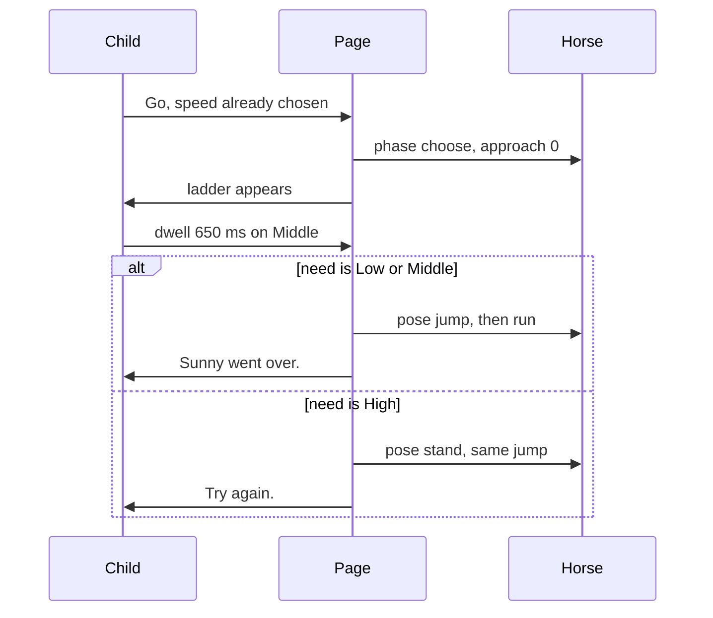

# Saddle Up!

**Author.** Unassigned.

**Date.** 2026-10-17.

**Status.** Accepted.

**Folder.** `saddle-up/index.html` in `/home/joseph/code/games`.

**Audience.** One child, ages 2 and up, on one device. The builder is the person who added Sugar Counter to this repo.

## Overview

Saddle Up! is a horse-farm game in the same family as Pop Pals, Sugar Counter, and Sun Garden. The page is one HTML file. It opens from `file://` and from GitHub Pages. It does not share code with the other games. There is no account, no install, and no network call except the optional local gaze socket.

The child keeps one horse for the page session. The first playable branch is the stable. The child picks a breed, then brushes, waters, saddles, cleans the hooves, and feeds the horse. A finished visit cheers and returns to the yard. Later branches add jumps, a one-lap race, cattle to bring in, a barn day that sends the child back to those same stable actions, and a vet visit. Breed changes the coat, the mane, the ribbon, and a name a child can say. It does not change speed or jump height.

## Background & Motivation

The public games already cover a counter, a garden, and a pop-the-animal board. A farm visit is the next quiet, repeatable chore loop. The child should be able to finish something kind on the first visit. Racing, ropes, and timers are for older bands, and they arrive only after the stable exists.

Today the repo is three folders, each with an `index.html`, plus `docs/superpowers/specs/2026-10-07-sugar-counter-design.md`. `README.md` tells a parent how to open each game and how gaze works. Games do not share a library. Pop Pals stores `{ mute, scores }` under the `localStorage` key `pop-pals-v1`. Sugar Counter and Sun Garden do not. Saddle Up! follows Sugar Counter and Sun Garden on storage. It stores nothing.

The gaze contract is already fixed. Sugar Counter names it at the top of the script.

```javascript
const GAZE_URL = "ws://127.0.0.1:7081";
const PLAY_DWELL_MS = 650;
const MENU_DWELL_MS = 1300;
const GAZE_FRESH_MS = 500;
const LEAVE_MS = 280;
```

A look of 650 ms fires a play target. A look of 1300 ms fires a menu button. The Eyes chip shows when the socket is open or a test look is held. The ring sits above the page at `z-index: 60` and ignores pointer events. On open, the page sends `new Uint8Array([1, 4, 0, 0, 0, 0, 5, 0, 0])`. Framing is a type byte, a little-endian `u32` length, then the payload. Type `1` with at least 56 bytes is a sample. Type `4` with at least 72 bytes is the homography, nine little-endian `f64` values. A non-empty type `4` shorter than 72 bytes is ignored. An empty type `4` clears the homography. A length above 1 MiB resets the buffer. Reconnect waits 2000 ms. An `https` page will not open `ws://127.0.0.1:7081`. GitHub Pages is `https://calledtoconstruct.github.io/games/`, so gaze works from `file://` or from `http://localhost`, not from the public Pages URL. Fullscreen the page on the panel that was calibrated. Copy this client into the new file. Do not extract it.

Art in this repo is canvas drawing plus a few inline SVG icons. Pop Pals, Sugar Counter, and Sun Garden have no `drawImage`, no ``, and no external image file. Sugar Counter draws the donut and uses inline SVG for the mute glyph, the cherry, and the face. Sun Garden sets `#mute` and `#full` to 72 by 72 px. Sugar Counter's spec asked for a 72 px short side, but the shipped `#mute, #full` rule is 64 by 64 px. Saddle Up! follows the 72 px floor. A single row of six 72 px targets with 8 px gaps needs 472 px. A 390 px phone cannot hold that row. The stable dock is two rows of three when the width is under 480 px.

Sugar Counter and Sun Garden start `requestAnimationFrame` and `connectGaze()` before `?selfcheck` runs, then set a `checking` flag so `frame` skips `step`. That still schedules a frame. Saddle Up! must not start the loop or the socket when `?selfcheck` is present. The check has to finish under a headless Chromium virtual-time budget without racing the clock.

Sound in all three games is an `AudioContext` oscillator started after the first pointer press or the first gaze action. Mute sets the master gain to 0. `prefers-reduced-motion: reduce` skips decorative motion and keeps the action. Sugar Counter still places the icing mark. Sun Garden still grows the plant. Here, the horse still drinks, and a jump still resolves.

Level names that a parent already knows from Sugar Counter and Sun Garden are Tiny Tots, Little Pals, Shopkeeper, and Rush. Pop Pals uses Explorer and Ranger because that game is a board, not a chore. This game uses the chore names.

## Goals & Non-Goals

**Goals.**

- Ship a complete stable visit on branch `saddle/stable` before any ride exists.
- Let mouse, touch, and gaze perform every action. Gaze is a dwell and a latch, not a blink.
- Keep every interactive short side at least 72 px, including on a 390 px wide phone.
- Map every activity onto Tiny Tots, Little Pals, Shopkeeper, and Rush. Tiny Tots can finish a session with no race, no cattle, and no fail state.
- Carry one horse object from the stable into every later activity.
- Keep later activities specified tightly enough that branch 2 does not invent a second horse.

**Out of scope.**

- A game engine, a bundler, npm, or a shared module pulled out of the other games.
- Breed stats that change jump height, race speed, or thirst time.
- Accounts, servers, analytics, and `localStorage`.
- More than one horse, and a keyboard name for the horse. Those stay open on purpose.
- Injury, blood, a fall, a scared horse, a syringe, or a lasso that acts like a weapon.
- Blink or wink input. Pop Pals and Sugar Counter do not have it. This game does not add it.
- Editing `pop-pals`, `sugar-counter`, or `sun-garden`.

## Proposed Design

### Session

One script in `saddle-up/index.html` owns the session. `go(place)` is the only writer of `place`. Care functions are the only writers of the horse. Paint reads both and does not change them.



`go(place)` accepts only `level`, `breed`, `yard`, `stable`, `hoof`, `jumps`, `race`, `cattle`, `chores`, and `vet`. There is no `barn` place and no `field` place. The diagram nodes are those strings. "Back to the barn" is `go("stable")` only while `chores` is non-null and phase is `"field"`. That call sets `chores.phase` to `"barn"`. It does not run from `"done"` or `"long"`. "Back to the cattle" is `go("chores")` and sets `chores.phase` to `"field"`. The stable painter runs whenever `place` is `"stable"`. It does not get a second stall. Both barn-day clocks advance only when `place === "chores"` and `chores.phase === "field"`. A morning visit is `go("stable")` while `chores` is null. That call does not create a chores record and does not set phase `"barn"`.

Chrome Back, the top-right button, is hidden for the whole time `chores` is non-null. That covers `"field"`, `"barn"`, `"done"`, and `"long"`. Mute and Full stay. The only mid-day exit is "Back to the cattle". The diagram edge from stable to yard is the morning button, and it is absent while a barn day record exists. The edge from chores to yard is the ending button "Back to the yard". That button calls `leaveChores()`, and only from `"done"` or `"long"`. `leaveChores()` copies `chores.morning` onto trough and saddle, sets `needs.drink` false, sets `needs.shoes` to 0, sets `chores` to null, and then calls `go("yard")`. A later Stable press is a morning visit.

`level` keeps the selected band across Back to Menu, the same way Sugar Counter keeps `levelId`. Changing band does not clear the horse and does not add hoof spots. Picking a different breed replaces the horse and clears care. Reloading the page clears everything, because nothing is stored.

Branch 1 only has `level`, `breed`, `yard`, `stable`, and `hoof`. The yard shows Stable and nothing else. Later branches append buttons. They do not show a locked button for a place the band cannot play.

### Age bands

Parent-facing names match Sugar Counter and Sun Garden. The small line under each name is parent copy. The child hears the banner sentences in the copy table below.

| Band | Ages | Stable hoof spots | Ride | Race rivals | Cattle | Barn day | Vet |
| --- | --- | --- | --- | --- | --- | --- | --- |
| Tiny Tots | 2 to 3 | 2 | One log, one Up button | Hidden | Hidden | Hidden | One check, no question |
| Little Pals | 4 to 5 | 3 | Three side-on jumps, walk only | 1, Pip | 2 slow cows | Hidden | Two checks, then a picture |
| Shopkeeper | 6 to 8 | 4 | Five side-on jumps, walk and trot | 2, Pip and Dot | 4 cows | 240 s, clock pauses in the barn | Three checks, then Yes or No |
| Rush | 9 and up | 4 | Six painted first-person jumps, walk, trot, and canter | 3, Pip, Dot, and Hank | 6 faster cows | 180 s, clock pauses in the barn | Two cases, three checks each, then a picture |

Tiny Tots never see a place word that means losing. A missed log stops the horse and says "Try again." Little Pals get the same miss. Shopkeeper and Rush get the same miss. Nobody falls off. Nobody's horse is hurt.

The yard hides a row the band cannot play. Hiding is the gate. There is no remote flag and no grayed lock.

Branch 1 blurbs, before any ride exists.

- Tiny Tots. Ages 2 to 3. Brush, water, and feed. No clock.
- Little Pals. Ages 4 to 5. The same barn. A few more spots on the hoof.
- Shopkeeper. Ages 6 to 8. The same barn. More spots on the hoof.
- Rush. Ages 9 and up. The same barn. More spots on the hoof.

Each later branch rewrites the `<small>` line for the bands that gained a place. Do not advertise a ride, a race, cattle, a barn day, or the vet until that branch adds the button.

Final blurbs, once `saddle/vet` exists.

- Tiny Tots. Ages 2 to 3. Take care of your horse, then a short walk. No clock.
- Little Pals. Ages 4 to 5. Care, a ride, and a gentle race. No clock.
- Shopkeeper. Ages 6 to 8. Jumps, a race, cattle, and a long barn day.
- Rush. Ages 9 and up. Faster jumps from the saddle, cattle, and a shorter barn day.

The vet is on every band's yard after `saddle/vet`. The blurb does not have to name it. The button does.

### The horse

`BREEDS` is a table, not four copies of the painter.

| id | Name on screen | Parent word | Coat | Mane | Ribbon |
| --- | --- | --- | --- | --- | --- |
| palomino | Sunny | Gold | `#e2b84a` | `#f3e2a0` | `#e23b3b` |
| pinto | Patches | Spots | `#8a4b2a` | `#2a2118` | `#ffc857` |
| gray | Cloud | Gray | `#d5d8de` | `#f7f7f5` | `#6eb5e8` |
| bay | Buddy | Brown | `#6b3a22` | `#1c140f` | `#2f8a3e` |

The child sees the name and the coat. The parent word sits in the `<small>` line under the breed button. "Palomino" is not on screen. A pinto also paints a `#fff6ea` patch on the barrel. That patch is cosmetic.

`drawHorse(ctx, box, pose)` is the side painter. Branch 1 poses are `stand`, `drink`, and `brush`. Any other pose paints `stand`, so a later branch can add `jump` and `run` without a second horse painter. The first-person view does not call `drawHorse` for the body. It paints ears and a forelock in the coat color at the bottom of the view.

There is no `jumpPower`, `speed`, or `stamina` field. A jump's speed lives on the jump record. A race's speed lives on the race record. Thirst lives on `needs` and only barn day writes it.

### Yard and stable

**Level screen.** Four `.choice` buttons, the same structure as Sugar Counter. A big button says "Let's go". Menu dwell is 1300 ms.

**Breed screen.** Banner "Pick a horse." Four buttons, short side at least 72 px. The button background is the coat, so the color match stays. The name sits on a paper chip, fill `#f4f0d8`, text ink `#2c2416`, for every breed. Ink on bay `#6b3a22` is about 1.6 to 1, and ink on pinto `#8a4b2a` is about 2.3 to 1. Both miss a 3 to 1 large-text floor. The chip is the contrast fix, not a later art pass. Choosing calls `pickBreed(id)` and `go("yard")`.

**Yard.** Banner is the horse's name. Buttons come from `ACTIVITIES` where `levels` contains the band. Branch 1 is only Stable. "Back to Menu" returns to the level screen and keeps the horse.

**Stable scene.** The canvas paints a wooden stall, the horse in the middle, a trough, a saddle rack, and two buckets. Real buttons sit on top of those pictures so gaze can use `elementFromPoint`, the same way Sugar Counter hits tray buttons. Care buttons are play targets. Mark them `data-play="true"`. Gaze uses 650 ms for `[data-play="true"]` and 1300 ms for every other button. Do not invent a third dwell time.

The dock holds Brush, Water, Saddle, Hooves, Apples, and Carrots. On a viewport at least 480 px wide, one row is allowed only if every short side is still at least 72 px. Under 480 px, two rows of three. A 390 px width fits three 72 px buttons with 8 px gaps in 232 px, and two rows are 152 px tall. Top chrome matches Sun Garden. Mute and Full are 72 by 72. Back sits on the right at a short side of 72 px. The Eyes chip is the word "Eyes".

The morning banner runs only while `chores` is null. It names the first undone step in this order. Brush, then Water, then Saddle, then Hooves, then food. The child may do them in any order. If water is already done, the banner skips it. The sentences are "Brush.", "Water.", "Saddle.", "Hooves.", and "Apples or carrots." While `chores` is set, the barn-day priority below owns the banner, even though `place` is `"stable"`.

A row of five pips shows the same five steps. A pip is paint, not a target. There is no point score.

**Brush.** `brushHorse()` sets `care.brushed` to true on the first tap or the first completed dwell. The pose goes to `brush` and three coat marks appear. After `TUNE.brushMs` the pose returns to `stand`. The flag is already true on the tap, so a child who leaves mid-stroke keeps the brush. A second tap does not clear the flag, does not add marks, and does not play the brush sound again. Reduced motion paints the marks and the stand pose on the same tap. `brushMs` is skipped.

**Water.** `fillTrough()` sets `care.trough` to `"full"` when it was `"empty"`. The trough paints `#3d8fd4`. The pose goes to `drink`. A second call while the trough is full changes nothing. Reduced motion still shows the lowered head and the blue water. The horse still drinks. The settled picture is the lowered head, not a loop. Normal motion may play one dip of `TUNE.drinkMs` and then rest in that pose.

**Saddle.** `putSaddle()` moves `care.saddle` from `"off"` to `"on"`. The rack paints empty and the saddle paints on the back in `#8c3b2a`. A call when the saddle is `"on"` does nothing. A call when the saddle is `"buckle"` does nothing. Only `fixBuckle()` closes a buckle, and only barn day sets `"buckle"`. Branch 1 never produces `"buckle"`.

**Hooves.** The Hooves button calls `go("hoof")`. The close-up is a hoof large enough that each dirt spot is a real `<button data-play="true">` at least 72 px on the short side. Gaze hits them with `elementFromPoint`, the same path as the dock. Spots are the first N entries of a fixed list, not random points. `pickBreed` freezes N from `TUNE.hoofSpots` for the band at that moment. Tiny Tots freeze 2. Little Pals freeze 3. Shopkeeper and Rush freeze 4. A later band change does not add dirt and does not drop a cleared spot. `state().hoofSpots` reports the frozen N. The next `pickBreed` rebuilds the list. Positions are fixed in the hoof circle so a test can sample a pixel. `spot-1` is the upper left, `spot-2` the upper right, `spot-3` the lower left, and `spot-4` the lower right.

`clearSpot(id)` sets that spot's `cleared` flag. Clearing a spot that is already clear does not change the count. The hoof is clean only when every spot is clear. There is no stored `clean` boolean. After the last spot, the banner says "Clean hooves." The view returns to the stable after `TUNE.hoofReturnMs`. That wait is 800 ms, and reduced motion treats it as 0 ms. A Done button returns immediately. Done is a menu button at 1300 ms. Cleanliness is already true before the return. The ready cheer waits until `place` is `stable` again, so it does not fight the hoof banner.

**Food.** `feed("apple")` and `feed("carrot")` each flip their own flag once. The child may feed both. The cheer needs one. A second tap on Apples leaves `care.foods.apple` true and does not stack apples. The apple paints at the mouth in `#d6453d`. The carrot paints in `#e07a1f`. An empty bucket is the settled picture.

**Cheer.** `ready(horse)` is true when the coat is brushed, the trough is full, the saddle is `"on"`, every hoof spot is clear, and at least one food flag is true. The banner becomes "Sunny is ready." with the real name. The cheer sound plays once per horse. Replacing the breed clears the one-shot. Chrome Back is the morning "Back to the yard" button. It is on screen before the cheer whenever `chores` is null. While a barn day record exists, chrome Back is hidden. Leaving the morning stable early is not a miss and gets no scolding sentence.

### Jumps

This is branch `saddle/jumps`. It reads the same horse for coat, name, and ribbon. It does not reset care and it does not write care.

Speed is chosen while `jumps.phase` is `ready` or `miss`, before the horse is choosing. Walk, Trot, and Canter are menu buttons at 1300 ms. They are hidden during `choose`, `jump`, and `gap`. "Go" is shown only in `ready` and `miss`. On a miss the horse stops, speed can be changed, and "Go" starts that same obstacle again.

During `choose` the only play targets are the height controls, at 650 ms. The sky is not a target. A tap or a dwell in the sky does not pick a height.

**Side view, for Tiny Tots, Little Pals, and Shopkeeper.** The horse stays at 28% of the play width. The horse does not scroll. The gate moves. `drawHorse` gains pose `jump` and pose `run`. A jump is a standard with colored rails.

- Low rail and Low button. Green, `#2f8a3e`.
- Middle rail and Middle button. Yellow, `#e2a62e`.
- High rail and High button. Orange, `#e07030`.

The rail the obstacle needs is brighter. The button shows the same color and the same relative height, plus the word. A child can match color and height without reading. Buttons stack in rail order and each short side is at least 72 px.

**Tiny Tots walk.** One log that needs Low. The only height control is a green "Up" button. Up picks Low. There is no Middle and no High, and no speed choice. The decision window is the walk window.

**Little Pals pasture.** Three jumps, needs Low, Low, Middle. Walk only. High also clears a Middle jump, because higher is enough. Low on the third jump is a miss.

**Shopkeeper schooling.** Five jumps, needs Low, Middle, Low, Middle, High. Walk and Trot. Default Walk.

**Rush line.** Six jumps, needs Low, Middle, Middle, High, Middle, High. Walk, Trot, and Canter. Default Trot. The view is painted first person, still on the same canvas.

**First person, Rush only.** No Three.js and no camera matrix. Paint a sky rect on the top 45% in `#9fd4f2`. Paint a grass trapezoid from a horizon at 45% down to the bottom edge. The horizon span is 40% of the play width. Paint a darker path trapezoid in the middle. Gate height is `lerp(24, 180, approach)` pixels. The top rail uses the need color. Two ear triangles and a forelock sit at the bottom center in the coat color, about 80 px tall. The height ladder is three real buttons on the right, not hotspots in the sky.

**Phases.** `state().jumps.phase` is only `ready`, `choose`, `jump`, `gap`, `miss`, or `done`. There is no `run` phase. Pose `run` is paint during `choose` and `gap`.

- `ready`, then Go, goes to `choose`. `approach` is 0. The ladder is on. `pick` is null.
- During `choose`, `approach` is elapsed time in this choose divided by `windowMs`, clamped at 1. Side view paints the gate center at `lerp(0.92, 0.46, approach)` of the play width. First person paints gate height from that same fraction. The window and the near gate end together.
- A ladder control is a play button. Changing target resets the dwell, the same rule as Sugar Counter `stepGaze`. A dwell that reaches 650 ms commits that step immediately through `pickHeight`.
- If the committed step is greater than or equal to the need, phase becomes `jump`.
- If the committed step is below the need, phase becomes `miss` immediately. A finished Low dwell cannot be replaced by High inside that window.
- Leaving a button before 650 ms resets the dwell and does not commit. Canter's window is 1600 ms so that uncommitted correction fits. Two committed dwells are 1300 ms. The extra 300 ms is the move from one ladder button to the next. Walk at 3000 ms and trot at 2000 ms already fit that correction.
- If `approach` reaches 1 and nothing has committed, phase becomes `miss`.
- `jump` lasts `jumpMs`, pose `jump`, ladder hidden. If a gate remains, phase becomes `gap`. If not, phase becomes `done`.
- `gap` lasts `gapMs`, ladder hidden, pose `run`. The cleared gate leaves and the next gate starts at approach 0. Then phase becomes `choose` for the next index.
- `miss` snaps the gate back to approach 0 in one step, in every motion setting. Pose `stand`. Banner "Try again." The ladder hides. Speed buttons and Go show. Go returns to `choose` for the same index. There is no tumble pose and no ease timer.

A clear banner is "Sunny went over." with the real name. The course ends when the last jump's `jump` phase finishes. Banner "All the jumps." Then "Back to the yard".

Windows, measured from the start of `choose` until an unpicked jump becomes `miss`.

| Speed | Window | Why this number |
| --- | --- | --- |
| Walk | 3000 ms | One 650 ms dwell fits late. An uncommitted move to another button also fits. |
| Trot | 2000 ms | Two 650 ms attempts plus a move still fit. |
| Canter | 1600 ms | 650 plus 650 is 1300. 300 ms remains to move from Low to High before either dwell commits. A dwell that already finished on a low step has already missed. |

### Race

Branch `saddle/race`. One lap on an ellipse so the child can see the horse go around a ring. Horses are `drawHorse` in pose `run`, scaled to 0.75 on the far side of the ellipse and 1 on the near side. Lane offsets keep the four horses from stacking. There is no 3D and no steering drag.

The ready screen sets speed with the same buttons the band already has from jumps. Tiny Tots do not get this place. Little Pals stay on Walk. "Go" starts the lap.

"Faster" is a play target. A pointer hold boosts immediately. A gaze dwell of 650 ms latches the boost, and the latch releases when the look stays off the button for `LEAVE_MS` of 280 ms. A single pointer click with no hold still boosts for `TUNE.tapBoostMs` of 400 ms. Boost adds `TUNE.boostPerSec` to progress per second.

Progress per second, lap length 1.

| Who | Rate | Lap time with no boost |
| --- | --- | --- |
| Child, walk | 0.08 | 12.5 s |
| Child, trot | 0.11 | 9.1 s |
| Child, canter | 0.14 | 7.1 s |
| Boost while held | plus 0.06 | Walk plus boost is 0.14, a 7.1 s lap |
| Pip | 0.10 | 10 s |
| Dot | 0.13 | 7.7 s |
| Hank | 0.17 | 5.9 s |

Little Pals race only Pip. A child who holds Faster for about half the lap on Walk finishes ahead of Pip, because 0.08 plus 0.06 is 0.14. A child who never presses Faster finishes behind Pip. Shopkeeper races Pip and Dot. Walk plus a held boost is 0.14. That beats Dot's 0.13. Trot plus a held boost is 0.17. Trot with no boost is 0.11 and loses to Dot. Faster is what beats Dot. Rush races Pip, Dot, and Hank. Canter plus a held boost is 0.20 and beats Hank. Trot plus a held boost is 0.17, the same rate as Hank. Rivals do not speed up to block the child. Their rates stay constant.

The lap ends at progress 1. It does not start a second lap. Place is computed on the step where the child's progress reaches 1. Rivals already at 1 before that step rank ahead of the child. Rivals that reach 1 on that same step tie the child, and the child ranks ahead of those ties. Trot plus a held boost therefore places ahead of Hank. Banner line one is always "You finished." Line two is "First!", "Second.", "Third.", or "Fourth." If the child is not first, line three names the winner, as in "Pip got there first." No sad face, no "lose", no collision, no fall. Reduced motion skips the bob and still paints the horse on the finish of the ellipse.

Rival names are Pip, Dot, and Hank. They are not breed names, so they cannot collide with Sunny, Patches, Cloud, or Buddy.

### Cattle

Branch `saddle/cattle`. Side view. The field does not scroll, and there is no camera. The horse is paint at `TUNE.field.horseXFrac` of the play width, pose `stand`, and it is not a button. Cows are large side-view bodies. The loop is a circle that settles over the shoulders and then disappears as the cow walks to the pen. It is not a noose and it does not pull the cow off its feet.

The child does not steer. At most two cows are on screen, one on each lane in `TUNE.field.lanes`. A waiting cow has center x fraction 1.15, has no button, and cannot be hit. When a cow becomes `in`, the lowest-index waiting cow grows a button and moves from 1.15 to lane x 0.48 over `TUNE.field.enterMs`, then patrols. Little Pals have no waiter. Shopkeeper has two. Rush has four. Six 96 px boxes cannot sit in a 390 px width. Two can.

An on-screen cow in state `out` is a real `<button data-play="true">` of `TUNE.cowBoxPx` on both sides, 96 by 96. `render` sets its `left` and `top` from the cow center. Gaze uses `elementFromPoint` and does not grow a second hit list. The grass is the play-rect button `#field`, also `data-play="true"`, under the cow buttons. A dwell or a tap on `#field` drops a loop on the grass. Gaze and pointer both do that. It is not pointer-only.

Patrol x pings between fractions 0.48 and 0.78 at `TUNE.herds[band].pxPerSec`. There is no `Math.random`. While the dwell key is that cow's button, that cow's patrol clock freezes. Other cows keep moving. A still look that starts on the button stays on it for the whole 650 ms, including at Rush's 48 px/s. The old margin, 48 px/s times 650 ms is 31 px inside a 96 px box, assumed a stationary camera and a look at the center. This rule does not rely on that. If the look leaves the button, the dwell resets and the patrol clock runs again.

On a successful loop the cow state goes from `out` to `loop`, then walks toward the pen center at `TUNE.field.walkToPenPxPerSec`. The pen rect is `TUNE.field.pen` in play-rect fractions. The count increments once, when the cow center is inside that rect, and the state becomes `in`. Banner "In the pen." plus a short count such as "Two to go." When the count matches the herd, banner "All in." A grass loop changes no count. Banner "Try again." A second loop on a cow that is already `loop` or `in` does not increment again.

| Band | Herd | On screen | Patrol speed | Pen |
| --- | --- | --- | --- | --- |
| Little Pals | 2 | 2 | 18 px/s | `TUNE.field.pen` |
| Shopkeeper | 4 | 2 | 32 px/s | `TUNE.field.pen` |
| Rush | 6 | 2 | 48 px/s | `TUNE.field.pen` |

Tiny Tots do not get this place. There is no timer on this branch. The timer arrives with barn day.

### Barn day

Branch `saddle/chores`. Do not build it before cattle exists. It reuses the cattle field, the cattle rules, and the stable writers. It does not copy the trough, the saddle, or the hoof painter into a second minigame.

The yard button says "Barn day". Shopkeeper gets 240 s. Rush gets 180 s. Those match the long waits already used as kind clocks in this family. Sugar Counter's Shopkeeper wait is 240 s. Tiny Tots and Little Pals do not get barn day.

Two clocks, both advanced only by `step` when `place === "chores"` and `chores.phase === "field"`. They do not move in the stable, on the ending screen, or while phase is `"barn"`, `"done"`, or `"long"`.

- `msLeft` counts down from the budget.
- `rideMs` counts up on the field. Events read `rideMs`, not `msLeft`, so a pause cannot skip a breakdown and a long barn visit cannot fire one either.

| Band | Budget | Drink at rideMs | Buckle at rideMs | Shoes at rideMs |
| --- | --- | --- | --- | --- |
| Shopkeeper | 240000 ms | 20000 | 50000 | 80000 |
| Rush | 180000 ms | 15000 | 35000 | 55000 |

Each event fires once. If the herd is already in, later events do not fire. Winning fast is allowed.

Starting barn day stores `chores.morning` as `{ trough, saddle }` from the horse at that instant. `morning.saddle` is only `"off"` or `"on"`. If it were already `"buckle"`, the snapshot stores `"on"`. The snapshot does not store `needs`. `again()` copies trough and saddle back, then sets `needs.drink` false and `needs.shoes` to 0 on its own. Events call writers. They do not assign horse fields themselves.

**Drink.** The drink event calls `emptyTrough()`. That sets `care.trough` to `"empty"` and `needs.drink` to true. A second call, when the trough is already empty and `needs.drink` is already true, changes nothing. Sweat drops paint while `needs.drink` is true. There is no second meter and the word dehydration is not on screen. Banner "Time for a drink." `fillTrough()` is the same function as the morning water. It sets the trough to full and `needs.drink` to false. A second fill while full and not thirsty does nothing.

**Buckle.** The buckle event calls `openBuckle()`. From `"on"` or `"off"` the saddle becomes `"buckle"`. From `"off"` the rack still ends empty, because the saddle is on the horse and unbuckled. A second call while the saddle is already `"buckle"` changes nothing. Banner "The saddle needs a buckle." The strap is a real `<button data-play="true">` at least 72 px. It calls `fixBuckle()`, which sets the saddle back to `"on"`. `putSaddle()` stays a no-op on `"buckle"`. Banner "The buckle is shut."

**Shoes.** The shoes event calls `askShoes()`, which sets `needs.shoes` to 4. A second call while the count is already 4 changes nothing. Banner "The shoes need a tap." Four horseshoe buttons, each at least 72 px, are not the hoof dirt spots and do not share ids with them. `tapShoe()` decrements the count by 1 and stops at 0. A tap at 0 does nothing. Banner "The shoes are set." The shoe taps are not a hurt hoof. No loose nail close-up, no limp pose that reads as pain. The horse stands.

`loopCow` follows its writer-table row. While `needs.drink` is true, or the saddle is `"buckle"`, or `needs.shoes` is above 0, the call is a grass miss for any id, including a real cow id. The cow stays `out`. The pen does not change. The field banner repeats the current need, in the order drink, then buckle, then shoes. "Back to the barn" is always on screen while `place` is `"chores"` and phase is `"field"`, including after Go again and before the next event. It is a menu button at 1300 ms. It calls `go("stable")`. Chrome Back is not on that screen.

**Barn overlay.** `place` is `"stable"` and `chores.phase` is `"barn"`. The stable painter runs. Morning dock buttons Brush, Saddle, Hooves, Apples, and Carrots are hidden. `putSaddle()` is not on screen. Water shows only when the trough is empty or `needs.drink` is true. The strap shows only when the saddle is `"buckle"`. The four shoes show only when `needs.shoes` is above 0. "Back to the cattle" is always there.

On a 390 by 844 layout the play rect sits under 88 px of chrome. The strap is a 72 px button on the saddle, and it does not cover the trough. Water, when shown, is a 72 px button at the trough. The bottom dock is two rows. The first row is the four 72 px shoes with 8 px gaps, 312 px wide, centered. The second row is Water, 72 px, then "Back to the cattle" with a short side of 72 px. Hidden morning buttons do not take a third row.

Barn banner priority, and only this priority, while phase is `"barn"`.

1. `needs.drink` is true. "Time for a drink."
2. Else the saddle is `"buckle"`. "The saddle needs a buckle."
3. Else `needs.shoes` is above 0. "The shoes need a tap."
4. Else "The clock is waiting."

The morning strings "Brush.", "Water.", "Saddle.", "Hooves.", and "Apples or carrots." do not run until `chores` is null. "The cattle are outside." is not a banner. The button "Back to the cattle" is the way out.

The clock paints as `m:ss` in the top middle. In the barn it keeps its digits. The last 30 s may use the warm paper `#fff6df`. It does not flash and it does not turn into a siren. Reduced motion does not freeze the clock. The clock is the task, not a decoration.

**Endings.** All cows in the pen with `msLeft` above 0. Phase becomes `"done"`. Banner "All in." `msLeft` hits 0 with cows still out. Phase becomes `"long"`. Banner "The day got long. The cattle can wait." Cows already in stay in the count on that screen. Both endings stay on `place` `"chores"`. They show "Go again" and "Back to the yard". They do not show "Back to the barn" or chrome Back. "Go again" calls `again()` and stays on the field. "Back to the yard" calls `leaveChores()`.

`leaveChores()` runs only from `"done"` or `"long"`. In order, it copies `chores.morning` onto `care.trough` and `care.saddle`, sets `needs.drink` false, sets `needs.shoes` to 0, sets `chores` to null, and then calls `go("yard")`. It keeps the breed and the other morning care flags. It never leaves the saddle at `"buckle"`. A call when `chores` is already null does nothing. A call from `"field"` or `"barn"` does nothing. The next `go("stable")` is a morning visit, with the morning dock and no phase `"barn"`.

`again()` resets cows to `out`, puts the first two on the lanes, parks the rest at x fraction 1.15, sets `pen` to 0, sets `msLeft` to the budget, sets `rideMs` to 0, sets every `events` flag false, copies `chores.morning` back onto `care.trough` and `care.saddle`, and sets `needs.drink` false and `needs.shoes` to 0. It never leaves `"buckle"`. It keeps the breed and the other morning care flags. It sets phase to `"field"` and stays on `place` `"chores"`. It does not say the child lost. Hiding in the barn forever does not end the day, because both clocks pause there.

Barn day does not write `localStorage`. Pop Pals uses `pop-pals-v1`. This game must not add a `saddle-up` key. A "come back tomorrow" save would greet a child with a broken buckle they do not remember. That is the wrong fail state for this family.

### The vet

Branch `saddle/vet`. The yard button says "Call the vet". The vet is a canvas person in a hat with a bag. No white-coat clutter, no needle, no blood. The on-screen name is "The vet".

Check buttons, each a play target at least 72 px, with these words. Hooves. Mouth. Teeth. Belly. Eyes. Coat. The ids are `hooves`, `mouth`, `teeth`, `belly`, `eyes`, and `coat`. The child picks one. The vet looks at that part. Reduced motion skips the lean and still shows the picture of the check. The sentences:

| Part | Sentence | Effect on the horse |
| --- | --- | --- |
| Hooves | "The vet looks." Then "Clean hooves." or "Let's pick the dirt." | If any spot is dirty, the exam clears every spot with the same `clearSpot` writer. |
| Mouth | "The vet looks in the mouth." | None. |
| Teeth | "The vet smooths a tooth." | None. |
| Belly | "The vet listens." Then "The belly sounds fine." or "Time for a drink." | If `needs.drink` is true, the exam calls `fillTrough()`. |
| Eyes | "Bright eyes." | None. |
| Coat | "The coat is shiny." or "A brush would help." | Does not call `brushHorse()`. The child can go brush. |

`checked` is the list of part ids for the current case only. Checking the same part again does not grow the list and does not repeat the treatment sound. It may repeat the sentence. Starting a case, including the second Rush case, sets `checked` to `[]`.

**Lessons.** The row in `VET_CASES[levelId]` is the only lesson source. `state().vet.lessonId` is `"hoof"`, `"teeth"`, `"water"`, or null. `state().vet.lesson` is only `"none"`, `"pending"`, or `"right"`. There is no `phase` field on `state().vet`. Every case sets `lesson` to `"none"` until `checked.length` equals that row's `checksNeeded`. The check that reaches the count sets `lesson` to `"pending"`. Picture buttons and Yes or No buttons render only while `lesson` is `"pending"`. A wrong answer sets nothing to a fail count. The banner says "Look again." and `lesson` stays `"pending"`.

- Tiny Tots. `VET_CASES.tiny` is empty. `lessonId` is null and `lesson` is `"none"`. One check is enough. Banner "The vet says all set."
- Little Pals. One row, `morning`, `lessonId` `"hoof"`, `checksNeeded` 2. After two checks, `lesson` becomes `"pending"` and two hoof-picture buttons appear, at least 72 px. Banner "Which hoof is clean?" The clean picture calls `answerLesson("clean")` and sets `lesson` to `"right"`. The dirty picture calls `answerLesson("dirty")` and stays pending. One check leaves `lesson` at `"none"` and shows no pictures.
- Shopkeeper. One row, `morning`, `lessonId` `"teeth"`, `checksNeeded` 3. After three checks, `lesson` becomes `"pending"`. Banner "Does a horse need smooth teeth to chew?" "Yes" is `answerLesson("yes")` and is right. "No" stays pending. Fewer than three checks leave `lesson` at `"none"` and show no Yes button.
- Rush. Row `morning` is the Shopkeeper teeth lesson. When that `lesson` becomes `"right"`, the next row starts. `caseId` becomes `"dusty"`, `checked` is `[]`, `lessonId` is `"water"`, and `lesson` is `"pending"` only after three new checks. Banner "Which bucket is water?" The blue bucket is `answerLesson("water")` and is right. The empty bucket stays pending. Banner "The vet says all set." only after that second `"right"`.

The vet does not undo a finished saddle or a fed apple. It may finish dirty hooves or a drink because those are the same care fields. Completion does not require the stable cheer. A child can call the vet first.

### Drawing, sound, and motion

Colors. Paper `#f4f0d8`, ink `#2c2416`, grass `#7dae4a`, wood `#a56b3c`, water `#3d8fd4`, saddle `#8c3b2a`, dirt `#6b4a2a`, clean hoof `#f0d2b0`. Shapes use a 4 px ink outline so they read at arm's length. Font stack matches Sugar Counter. `"Arial Rounded MT Bold", "Trebuchet MS", "Segoe UI", sans-serif`.

The canvas covers the window. Backing-store ratio caps at 2, as in Sugar Counter. Resize rebuilds layout from the live window. Hit targets are fractions of the play rect, then expanded until the short side is at least 72 px.

`prefers-reduced-motion: reduce` skips brush travel, the drink dip, race bob, dust, and the vet lean. It does not skip state changes, the clock, or cow patrol. The jump still resolves. Miss still snaps to approach 0. The horse still ends in the drink pose with water in the trough.

The oscillator envelope copies Sugar Counter's `osc` helper. The master gain copies Sun Garden. It is 0.5 while unmuted and 0 while muted. Sugar Counter uses 0.6 and Pop Pals uses 0.65. Do not copy those gains. Resume on the first pointer press and the first gaze action. Names. `brush`, `water`, `saddle`, `hoof`, `munch`, `cheer`, `jump`, `miss`, `race`, `loop`, `buckle`, `vet`. Mute is a real button, `aria-pressed`, with the same inline SVG shapes Sugar Counter uses for sound on and sound off. No recorded audio files.

### Tunables

One object, `TUNE`, next to the gaze constants. Do not add dwell times. The gaze constants stay separate so a reader can see they are the family contract, not farm tuning.

```javascript
const TUNE = {
  minTargetPx: 72,
  hoofSpots: { tiny: 2, little: 3, shop: 4, rush: 4 },
  hoofReturnMs: 800,
  brushMs: 700,
  drinkMs: 600,
  jumpMs: 700,
  gapMs: 1500,
  windowsMs: { walk: 3000, trot: 2000, canter: 1600 },
  gateXFrac: { far: 0.92, near: 0.46 },
  gatePx: { far: 24, near: 180 },
  courses: {
    tiny: { view: "side", speeds: ["walk"], needs: [1] },
    little: { view: "side", speeds: ["walk"], needs: [1, 1, 2] },
    shop: { view: "side", speeds: ["walk", "trot"], needs: [1, 2, 1, 2, 3] },
    rush: { view: "first", speeds: ["walk", "trot", "canter"], needs: [1, 2, 2, 3, 2, 3] }
  },
  raceRates: { walk: 0.08, trot: 0.11, canter: 0.14, boost: 0.06, pip: 0.10, dot: 0.13, hank: 0.17 },
  tapBoostMs: 400,
  field: {
    scroll: false,
    horseXFrac: 0.18,
    pen: { x: 0.02, y: 0.08, w: 0.24, h: 0.84 },
    lanes: [0.38, 0.72],
    patrolX: [0.48, 0.78],
    waitXFrac: 1.15,
    onScreen: 2,
    enterMs: 400,
    walkToPenPxPerSec: 120
  },
  herds: {
    little: { cows: 2, pxPerSec: 18 },
    shop: { cows: 4, pxPerSec: 32 },
    rush: { cows: 6, pxPerSec: 48 }
  },
  cowBoxPx: 96,
  chores: {
    shop: { budgetMs: 240000, drinkMs: 20000, buckleMs: 50000, shoesMs: 80000 },
    rush: { budgetMs: 180000, drinkMs: 15000, buckleMs: 35000, shoesMs: 55000 }
  },
  shoeTaps: 4
};
```

Need values in `courses` are 1 for Low, 2 for Middle, and 3 for High. Tiny Tots map Up onto 1.

### How input reaches an action



Every play target is a real button with `data-play="true"`. That includes the care dock, hoof spots, the ladder, Up, Faster, cow buttons, the grass button `#field`, the buckle strap, and the four shoes. Menu chrome has no `data-play`. Gaze stays on the copied Sugar Counter path. `elementFromPoint`, then `closest("button")`. A play button dwells 650 ms. Any other button dwells 1300 ms. Do not add a geometric hit walk for spots or cows. Moving cows are the same buttons, moved with `left` and `top` inside `render`. Empty grass is `#field`, so gaze can miss on purpose. A sky point is not a button and does not pick a height.

One pointer at a time. `touch-action: none` on the page. A second contact is ignored until the first ends. While a pointer is down, gaze dwell does not advance. A pointer press releases a gaze latch first. Play targets and menu buttons call the same writers as `window.saddleUp`. There is no mouse-only drag. `tap`, `look` once a dwell commits, and every writer call `render` before they return, including while `checking` is true and the frame loop is off.

Jump sequence.



### Selfcheck

`?selfcheck` runs at load. The script parses `location.search` before `requestAnimationFrame` and before `connectGaze`. When the flag is present it calls `selfCheck()`, writes the result, and does not start the loop or the socket.

```javascript
const params = new URLSearchParams(location.search);
if (params.has("selfcheck")) {
  const result = selfCheck();
  const pre = document.createElement("pre");
  pre.id = "selfcheck-result";
  pre.textContent = JSON.stringify(result);
  document.body.appendChild(pre);
  document.title = result.ok ? "SELFCHECK_OK" : "SELFCHECK_FAIL";
} else {
  requestAnimationFrame(frame);
  connectGaze();
}
```

`selfCheck` sets `checking` and `suppressReconnect` anyway, so a later edit cannot sneak a frame in. It drives time only through `step(now)`, starting from a timestamp of 10000, the same pattern as Sugar Counter. `look` stamps freshness from that clock. `performance.now()` must not decide a dwell during the check. No `setTimeout` waits. Each case bounds its `step` loop. The hook does not need a Tobii device. `look` is the test gaze, as `window.sugarCounter.look` is for Sugar Counter.

`step` copies Sugar Counter's clock clamp, not Sun Garden's. Sun Garden ignores a `dt` above 1 second. Sugar Counter accepts `dt > 0 && dt < 120` seconds. A 10 second step advances `msLeft`, patrol, and race progress. A step of 120 seconds or more does not advance those clocks. Hook actions paint before they return, so pixel samples run after `tap` or a committed `look` with the loop off.

Pixel samples use `getImageData` at points `centers().samples` returns, after that paint. Compare channels. Do not compare a full screenshot.

**Branch 1 cases.**

1. `breed("pinto")` or a tap on Patches sets `state().name` to "Patches" and the visible heading to Patches.
2. Tap Brush. `state().brushed` is true, the banner is no longer "Brush.", and a coat-mark sample is not the plain coat color.
3. Tap Water. The trough sample's blue channel exceeds its red channel by at least 30. `state().trough` is `"full"`.
4. Tap Water again. `state().trough` is still `"full"` and the blue sample stays water. The trough did not toggle empty.
5. Tap Saddle. The back sample moves toward `#8c3b2a`. Tap Saddle again. `state().saddle` is still `"on"`.
6. On Tiny Tots, clear one hoof spot. `state().hoofCleared` is 1 and `state().ready` is false. Clear that same spot again. The count stays 1. The dirt pixel of a remaining spot stays `#6b4a2a`.
7. Clear the last spot. `state().hoofCleared` equals `state().hoofSpots`. The spot pixel moves toward `#f0d2b0`. Step past the return. `state().place` is `"stable"`.
8. Tap Apples. `state().apple` is true and the mouth sample moves toward `#d6453d`. Tap Apples again. `state().apple` is still true. Tap Carrots. `state().carrot` is true too.
9. With brush, water, saddle, hooves, and one food done, `state().ready` is true and the banner is "Patches is ready." when the horse is Patches.
10. `look` on Brush for 640 ms does not set `brushed`. `look` for 660 ms does. A tap on Carrots still feeds after that, so gaze and pointer share writers.
11. `look` on Let's go for 600 ms does not leave the level screen. `look` for 1300 ms does.
12. `targetsAt(390, 844)` and `targetsAt(1024, 768)` both report a short side of at least 72 for every target, including hoof spot buttons. Live buttons on the real window do too when the window is at least 390 by 700. Under 320 px the run fails the size case the way Sugar Counter does, and it does not pretend the dock fits.
13. The Patches chip and the Buddy chip use paper fill `#f4f0d8` and ink text `#2c2416`. The button behind each chip keeps the coat color. A `look` of 660 ms on `spot-1` clears that spot. A `look` of 660 ms on hoof leather that is not a spot button does not.

**Later cases, added by that branch.**

Jumps. Let the walk window expire with no pick. `state().jumps.phase` is `"miss"`, `approach` is 0, the banner is "Try again.", and the obstacle index does not advance. Go, then pick Up on the Tiny Tots log and step `jumpMs`. `state().jumps.cleared` is 1. On Shopkeeper, a committed Low on a Middle jump sets phase to `"miss"` before the window ends, and a committed Middle after Go clears it. On Rush, `centers().ladder.high` has a short side of at least 72. A `look` at window fraction `0.5, 0.2` during `choose` does not set a pick. A 660 ms look on High clears a High jump. A 400 ms look on Low, then a 660 ms look on High, inside one 1600 ms canter window, commits High and not Low. A 660 ms look on Low against a High need sets phase to `"miss"` at once, and a following High look does not clear until Go.

Race. Two scripted Little Pals laps. The held lap is `look` on Faster, `step` 660 ms so the latch is on, then `step` in chunks under 120 s until progress is 1. The child finishes ahead of Pip. Do not use `tap` for that lap. `tap` on Faster boosts only `tapBoostMs`. With no Faster, Pip is first, the child banner is "You finished.", and the text "lose" is absent. Progress stops at 1. A scripted tie at Hank's rate ranks the child ahead.

Cattle. `look` at the first on-screen cow center, then `step` 660 ms. The cow leaves `"out"` and its button center does not move during that dwell. After it reaches the pen, the count is 1. A second dwell on that cow stays 1. A 660 ms `look` on `#field` leaves the count. After every cow arrives, the banner is "All in."

Barn day. `step` 10 s on `place` `"chores"` and phase `"field"`. `msLeft` drops by about 10 s. `step` 10 s after `go("stable")` and `msLeft` stays. At the drink time, `emptyTrough` has run, the trough is `"empty"`, and the banner is "Time for a drink." `fillTrough()` clears the need. While the buckle is open, a cow tap leaves that cow's `state` at `"out"` and does not increment the pen. `fixBuckle()` allows the next loop to leave `"out"`. At `msLeft` 0 with cows out, the banner is "The day got long. The cattle can wait." and "Back to the barn" is not on that screen. `again()` leaves `care.saddle` as `"on"` or `"off"`, never `"buckle"`, and sets `events.buckle` false. From phase `"long"` with the saddle at `"buckle"`, the ending Back to the yard restores `care.saddle` from `chores.morning`, sets both needs clear, sets `chores` to null, and sets `place` to `"yard"`. The next `go("stable")` does not set phase `"barn"`. `localStorage.getItem("saddle-up")` is null, and `pop-pals-v1` is untouched.

Vet. Tap Hooves. The banner contains "The vet looks." and `state().vet.checked` lists hooves once. A second tap does not grow the list. On Little Pals, one check leaves `lesson` at `"none"` and shows no picture buttons. A second check sets `checked.length` to 2 and `lesson` to `"pending"`. The dirty picture leaves `lesson` at `"pending"`, and the clean picture sets `"right"`. On Tiny Tots, one check sets the banner to "The vet says all set." and no Yes button is on screen. On Rush, after the teeth lesson is `"right"`, `checked.length` is 0 and `lessonId` is `"water"`. `lesson` stays `"none"` until three new checks.

### Manual play, one path per branch

1. Stable. Tiny Tots, pick Sunny, brush, water, saddle, clear both spots, feed an apple, read "Sunny is ready.", go back to the yard, go back to the menu, press Let's go, and still see Sunny.
2. Jumps. Little Pals, miss the middle jump on purpose, read "Try again.", clear it, finish the three. Then Rush, choose Canter, pick Low on a High jump, miss, pick High, clear it. Confirm the sky does nothing.
3. Race. Shopkeeper, hold Faster, finish one lap, read "You finished.", confirm the horses stop.
4. Cattle. Little Pals, settle a loop on both cows, watch each one reach the pen, read "All in."
5. Barn day. Shopkeeper, ride until "Time for a drink.", open the barn, fill the trough, shut the buckle, tap the four shoes, return, and either finish the cows or let the clock end and read "The day got long. The cattle can wait." Then press Back to the yard, open Stable, and see the morning dock. The strap is gone.
6. Vet. Little Pals, call the vet, check hooves and teeth, pick the clean hoof, read "The vet says all set."

Also play branch 1 on a 390 px wide phone layout and confirm the dock is two rows of targets a thumb can hit.

### Risks

**High. A jump target that only a precise pointer can hit.** The sky is not a control. The ladder is 72 px buttons. Canter's window is 1600 ms. Younger bands never see that window.

**High. Hoof dirt drawn on the full horse is too small to tap or to look at.** The hoof opens to a close-up. Spots are not specks on the leg.

**High. Barn day feels like losing or like a hurt horse.** Copy is fixed in the tables above. The clock pauses in the barn. The long-day line does not say the child failed. There is no injury pose.

**Medium. Selfcheck races the animation clock.** The loop and the socket stay off when `?selfcheck` is set. Dwells read `step`'s timestamp.

**Medium. The one file gets large.** Pop Pals is 1982 lines, Sun Garden is 2641, and Sugar Counter is 2795, measured with `wc -l` on 2026-10-16. A full Saddle Up! may land around 4000 to 5500 lines. That is a guess from those three files, not a measurement of this game. Do not split the file and do not add a build to escape the size. One `TUNE`, one horse, and one writer per action are how the file stays readable.

**Medium. Rivals a child can never pass.** The rates are constant and published above. Walk plus a held boost beats Pip. Canter plus a held boost beats Hank. If playtesters still cannot pass, change `TUNE.raceRates` only.

**Low. Gaze on the public Pages site.** The site is `https`. The socket will not open. The README says so, as it does for the other games. Do not proxy gaze through a server.

## API / Interface Changes

There is no old API. The page adds `window.saddleUp` as soon as the script runs, the same moment Sugar Counter publishes `window.sugarCounter`.

```javascript
window.saddleUp = {
  level(id) {},
  breed(id) {},
  go(place) {},
  look(nx, ny) {},
  releaseLook() {},
  dwell() {},
  eyes() {},
  tap(nx, ny) {},
  centers() {},
  targetsAt(w, h) {},
  state() {},
  step(now) {},
  selfCheck() {}
};
```

`eyes()` returns `{ on, live }`. `dwell()` returns the ring fill from 0 to 1. `centers()` returns window fractions and pixel boxes for every live target, plus `samples` for the trough interior, the saddle contact on the back, one hoof spot, the mouth, and a coat mark. `targetsAt(w, h)` returns those boxes for a pretend viewport so the 390 px dock is testable when the real window is larger. `state()` returns plain data, not DOM nodes.

```javascript
{
  level: "tiny",
  place: "stable",
  breed: "palomino",
  name: "Sunny",
  brushed: false,
  trough: "empty",
  saddle: "off",
  hoofCleared: 0,
  hoofSpots: 2,
  apple: false,
  carrot: false,
  ready: false,
  needs: { drink: false, shoes: 0 },
  banner: "Brush.",
  jumps: null,
  race: null,
  cattle: null,
  chores: null,
  vet: null
}
```

Later branches fill the matching record instead of leaving a fake one. Branch 1 sets `jumps`, `race`, `cattle`, `chores`, and `vet` to `null`.

`state().jumps` when a course is running.

```javascript
{ view: "side", speed: "walk", index: 0, need: 1, phase: "choose", approach: 0.25, pick: null, cleared: 0, windowMs: 3000 }
```

`phase` is `ready`, `choose`, `jump`, `gap`, `miss`, or `done`. `approach` is 0 outside `choose`.

`state().race` when a lap is running.

```javascript
{ speed: "walk", phase: "run", child: 0.2, rivals: [{ name: "Pip", progress: 0.25 }], place: null, boost: false }
```

`state().cattle`.

```javascript
{ phase: "run", pen: 0, cows: [{ id: "cow-1", state: "out" }] }
```

`state().chores`.

```javascript
{ phase: "field", msLeft: 240000, rideMs: 20000, events: { drink: true, buckle: false, shoes: false }, morning: { trough: "full", saddle: "on" } }
```

`phase` is `field`, `barn`, `done`, or `long`.

`state().vet`.

```javascript
{ caseId: "morning", checked: ["hooves", "teeth"], lessonId: "hoof", lesson: "pending" }
```

`lessonId` is `"hoof"`, `"teeth"`, `"water"`, or null. `lesson` is `"none"`, `"pending"`, or `"right"`. `state().vet` has no `phase` field. The sample is Little Pals after `hooves` and `teeth`, with `checked.length` equal to `checksNeeded`, before the picture is answered. `lesson` is `"none"` on any earlier check.

Query flags besides `selfcheck` may deep-link a manual check. Unknown flags do nothing. A known flag whose branch is not in the file yet does nothing, the same as an unknown flag. A flag must not set the gaze URL. If `horse` is null, the flag calls `pickBreed("palomino")` first. If a horse already exists, the flag keeps it and does not rebuild spots. Then it sets `levelId` and `go(place)`.

| Flag | Ignored until | level | place |
| --- | --- | --- | --- |
| `play` | Never. Branch 1 has it. | `tiny` | `stable` |
| `jumps` | `saddle/jumps` | `little` | `jumps` |
| `race` | `saddle/race` | `shop` | `race` |
| `cattle` | `saddle/cattle` | `little` | `cattle` |
| `chores` | `saddle/chores` | `shop` | `chores` |
| `vet` | `saddle/vet` | `little` | `vet` |

`?play` on branch 1 lands in the stable with Sunny only when no horse was picked yet. It does not open a ride. Sugar Counter's `?play` starts Tiny Tots free play. This flag starts Tiny Tots stable care. The other flags wait for their branch.

## Data Model Changes

Nothing is migrated. There is no previous save. The session is one object.

```javascript
session = {
  levelId: "tiny",
  place: "level",
  horse: null,
  cheered: false,
  jumps: null,
  race: null,
  cattle: null,
  chores: null,
  vet: null
};

horse = {
  breedId: "palomino",
  name: "Sunny",
  care: {
    brushed: false,
    trough: "empty",
    saddle: "off",
    spots: [{ id: "spot-1", cleared: false }, { id: "spot-2", cleared: false }],
    foods: { apple: false, carrot: false }
  },
  needs: { drink: false, shoes: 0 }
};
```

Legal `care.saddle` values are `"off"`, `"on"`, and `"buckle"`. Legal `care.trough` values are `"empty"` and `"full"`. `needs.shoes` is an integer from 0 to 4. `care.spots.length` is frozen by `pickBreed` and is what `state().hoofSpots` returns. Hoof cleanliness is `spots.every((s) => s.cleared)`. Readiness is the function `ready(horse)`, not a stored flag that can disagree with the pips. `cheered` only stops the cheer sound from playing twice for the same horse. `chores.morning` is the trough and saddle snapshot taken when barn day starts. `again()` copies it back.

`ACTIVITIES` is the yard table. Branch 1 contains Stable. Each later branch appends one row.

```javascript
const ACTIVITIES = [
  { id: "stable", label: "Stable", levels: ["tiny", "little", "shop", "rush"] },
  { id: "jumps", label: "Ride", levels: ["tiny", "little", "shop", "rush"] },
  { id: "race", label: "Race", levels: ["little", "shop", "rush"] },
  { id: "cattle", label: "Cattle", levels: ["little", "shop", "rush"] },
  { id: "chores", label: "Barn day", levels: ["shop", "rush"] },
  { id: "vet", label: "Call the vet", levels: ["tiny", "little", "shop", "rush"] }
];
```

Writers, and what a second call does.

| Writer | First call | Second call |
| --- | --- | --- |
| `pickBreed(id)` | Replaces `horse`, freezes hoof N from the current band, clears care | Same breed does nothing |
| `brushHorse()` | `brushed` true | No change |
| `fillTrough()` | Empty becomes full, `needs.drink` false | Full and not thirsty does nothing |
| `emptyTrough()` | Trough `"empty"`, `needs.drink` true | Already empty and thirsty does nothing |
| `putSaddle()` | `"off"` becomes `"on"` | `"on"` or `"buckle"` does nothing |
| `openBuckle()` | `"off"` or `"on"` becomes `"buckle"` | Already `"buckle"` does nothing |
| `fixBuckle()` | `"buckle"` becomes `"on"` | Any other saddle value does nothing |
| `clearSpot(id)` | That spot `cleared` true | That spot stays cleared |
| `feed(kind)` | That food true | That food stays true |
| `askShoes()` | `needs.shoes` becomes 4 | Already 4 does nothing |
| `tapShoe()` | `needs.shoes` drops by 1 if above 0 | At 0, no change |
| `pickHeight(step)` | In `choose`, a step at or above the need starts `jump`. A lower step starts `miss`. | Any call after phase left `choose` does nothing until Go |
| `loopCow(id)` | If `needs.drink` is true, the saddle is `"buckle"`, or `needs.shoes` is above 0, the cow stays `out`. That call is the grass miss for any id. Otherwise `out` becomes `loop`. | `loop` or `in` does not change the pen count. `id` null is the grass miss. A blocked call leaves `state` `"out"`. |
| `again()` | Restores `chores.morning`, clears events, needs, cows, and both clocks, stays on the field | A second call with events already clear and phase `"field"` stays there |
| `leaveChores()` | From `"done"` or `"long"`, copies `chores.morning` onto trough and saddle, clears needs, sets `chores` to null, then `go("yard")` | Already null does nothing. `"field"` or `"barn"` does nothing |
| `vetCheck(part)` | Adds the part once on this case and may clear dirt or thirst | Does not grow `checked` |
| `answerLesson(choice)` | The right choice sets `lesson` to `"right"` | A wrong choice stays `"pending"`. A second right call stays `"right"` |

Cow states are `out`, `loop`, and `in`. A cow cannot be `in` without having been counted at the pen. Arrival is the only increment.

Course, race, and herd tables live in `TUNE`. Vet cases live in the `VET_CASES` object beside it, keyed by band. They are data, not branches scattered through the painters.

```javascript
const VET_CASES = {
  tiny: [],
  little: [{ id: "morning", lessonId: "hoof", checksNeeded: 2 }],
  shop: [{ id: "morning", lessonId: "teeth", checksNeeded: 3 }],
  rush: [
    { id: "morning", lessonId: "teeth", checksNeeded: 3 },
    { id: "dusty", lessonId: "water", checksNeeded: 3 }
  ]
};
```

Little Pals do not read the teeth row. Shopkeeper does not read the hoof row. Rush resets `checked` when `dusty` starts. Tiny Tots have no lesson row.

## Alternatives Considered

**Three.js for the mounted view.** It would import a library the page must vendor, because a build and npm are out. Gaze would raycast into a scene the other games never use. File size and hit testing both get worse for a sky click the youngest players should not have to make. Canvas already paints a trapezoid, a growing gate, and a button ladder. Rejected.

**Side view for every band, including Rush.** Easier to build, and one painter. It drops the mounted vantage the jump setting asked for. Rejected as the only view. Side view stays for Tiny Tots, Little Pals, and Shopkeeper, where a rail they can match to a button matters more than a horizon. Rush gets the painted first person.

**First person for every band.** A 2-year-old would have to judge a gate in the sky. Even with a ladder, the side view teaches Low and High with the rails in the same picture as the horse. Rejected for the younger bands.

**A drag lasso or a dragged jump height.** Gaze cannot perform a precise drag. Sugar Counter already refuses a scoop-drag for gaze and uses a dwell instead. A dwell on a cow, and a dwell on a ladder button, are the whole throw and the whole jump. Rejected.

**A shared gaze file used by all four games.** The repo rule is that games do not share code. Copy the small client. Rejected.

**DOM horses with no canvas.** Fine for the stable buttons, and the buttons are real DOM. The jump gate, the ellipse race, and the cow patrol want a scene painter. Sugar Counter already splits it this way. Canvas scene, DOM targets. Rejected as a full replacement.

**Breed speed in the race.** A slower horse reads as a worse horse. The coat and the name are the difference. Rejected, including for later branches. Do not leave an unused `jumpPower` field "for later".

**Survival as a new barn with its own water button.** That would fork `fillTrough` and drift from the stable. Barn day calls the stable writers and paints the stable scene. Rejected.

**Remember the horse in `localStorage`.** Pop Pals can do it for a score list. A saved buckle is a punishment on the next morning. Rejected for every branch in this design.

## Security & Privacy Considerations

One child plays a static file. The threat model is small, and it should stay small.

- No account, no cookie, no fetch to a game server, no analytics beacon.
- The only socket is the hardcoded `ws://127.0.0.1:7081`. Query parameters must not replace that URL.
- Gaze samples and the homography stay in memory for the page lifetime. Do not log coordinates. Do not put them in `state()` beyond the test hook's live booleans. `eyes()` returns flags, not x and y. Tests that need a point already passed it to `look`.
- `?selfcheck` never opens the socket. If a socket exists, the check closes it and sets `suppressReconnect`, matching Sugar Counter's `selfCheck` setup.
- `https` pages fail the socket constructor or the connection. That is expected. Do not fall back to a remote websocket.
- No personal data. Names are the four breed names and the three rival names. An open question about a typed name must not be "solved" by sending the name anywhere.
- `localStorage` is untouched. A test that finds a key containing `saddle` is a failure.
- Treat input as coordinates and button ids. There is no string that becomes HTML. Breed ids pass through a known table or they do nothing.

## Observability

There is no metrics pipeline. A beacon would break offline play and the privacy rule above.

What a developer can see.

- `?selfcheck` writes JSON into `#selfcheck-result` and sets `document.title` to `SELFCHECK_OK` or `SELFCHECK_FAIL`. The JSON is `{ ok, failures }`. Each failure is one sentence, the Sugar Counter shape.
- `window.saddleUp.state()` and `centers()` from the console.
- The banner is a `role="status"` node, the same idea as Sugar Counter's `#note`, so a screen reader speaks the short sentence when it changes.
- The Eyes chip is the only gaze health light. On means the socket is open or a test look is held. The ring shows only while a sample is fresher than 500 ms.

What a parent can see. The banner, the pips, the place word, and the clock on barn day. No debug overlay in normal play.

## Rollout Plan

Playtest branches stack in the order in the PR plan. Each branch is opened at `file://` and played in a browser before the next branch starts. GitHub Pages updates only when a publish branch lands on `main`. The first publish describes the stable only.

There is no feature-flag service. A place is on when its row is in `ACTIVITIES` and the band is in `levels`. Revert the branch to roll back. There is no save to migrate and no cache to bust beyond a normal Pages deploy.

Deep links `?play`, `?jumps`, `?race`, `?cattle`, `?chores`, and `?vet` are for the person building the branch. They are not a parent mode.

## Open Questions

**A typed horse name.** Version 1 uses Sunny, Patches, Cloud, and Buddy. A text field is a poor control for gaze and for age 2. If a later version wants a name, a parent would type it. That needs its own spec. Do not add the field on these branches.

**More than one horse.** Version 1 keeps a single `horse` binding. An array of horses, a pasture of guests, or switching horses mid-yard is a different game. Do not leave empty slots in the session object.

A typed horse name and more than one horse are the only open product questions. The place enum, the canter commit rule, the cattle paths, and the vet lesson ids are specified above. If two sentences disagree, the place enum and the writer table win. The `loopCow` row is the need gate. The `leaveChores` row is the only yard exit from a finished or long barn day.

## References

- `README.md` in `/home/joseph/code/games`, for the Pages URLs, the gaze paragraph, and the "add a game" rule.
- `docs/superpowers/specs/2026-10-07-sugar-counter-design.md`, for the original gaze contract, dwell times, and the `window.sugarCounter` hook. The shipped game has grown past that spec. Where they differ, follow the shipped script.
- `sugar-counter/index.html`, for `PLATE_CAPS` as the tunable pattern, `selfCheck`, `look`, `step`, mute, and the level buttons. The loop starts near the bottom of the script, before `?selfcheck`. Do not copy that order.
- `sun-garden/index.html`, for 72 px mute and full buttons, canvas plants, and the same selfcheck title pattern.
- `pop-pals/index.html`, for canvas animals, the `localStorage` key `pop-pals-v1`, and level names this game does not reuse.
- Public play. `https://calledtoconstruct.github.io/games/`.

## Key Decisions

**One file, canvas scene, DOM targets.** The repo already ships games this way. A vendored 3D library does not earn its weight when a trapezoid and a button ladder can show the mounted view.

**Side view for the younger ride, painted first person for Rush.** Matching colored rails is something a 4-year-old can do. The sky is never the hit target. Rush still gets the vantage from the saddle without Three.js.

**One horse, no breed physics.** Later branches read `breedId`, `name`, coat, mane, and ribbon. Speed and jump need live on the activity record. A gentle difference that changes who wins is a worse horse, so it is not in the model at all.

**Care is a handful of writers with derived readiness.** `saddle` is one field, not `on` plus `buckle` as two booleans that can disagree. Hoof cleanliness falls out of the spots. A second tap converges to the same horse. Barn day must call those writers. Clock events call `emptyTrough`, `openBuckle`, and `askShoes`. They do not assign horse fields on their own. The buckle value and the thirst flag exist on the horse in the first branch. Only the stable values occur there until barn day.

**Dwell times stay 650 ms and 1300 ms.** Play targets, including the height ladder, the Faster button, the cow buttons, and the care dock, use 650 ms. Changing target resets the dwell. A finished Low dwell misses at once and cannot be replaced. Canter is 1600 ms so a look that leaves Low before 650 ms can still finish High. Speed and menu chrome use 1300 ms, and speed is chosen only in `ready` and `miss`.

**Miss, thirst, and the long day are gentle.** Try again. Time for a drink. The saddle needs a buckle. The day got long. No fall and no injury art, on every band.

**Tiny Tots can finish on the stable alone.** The first branch does not build a framework and then wait for a ride. The yard grows by appending `ACTIVITIES` rows.

**No storage.** Barn day pauses inside the session. `leaveChores()` restores the morning trough and saddle and drops the chores record before the yard, so the next stable visit is not a leftover barn.

**Selfcheck does not start the frame loop.** That is stricter than Sugar Counter and Sun Garden, on purpose, so virtual time cannot race `step`.

**The playtest stack is linear, and the README publish is not its parent.** Jumps sit on the stable, not on the README commit. Publishing the stable does not force unfinished rides onto `main`.

## PR Plan

These are stacked playtest branches. Each one is playable in a browser before the next starts. The base of each ride branch is the previous ride branch. `saddle/pages` is the exception. It branches from `saddle/stable` and is not the parent of `saddle/jumps`.

### 1. Stable visit

**PR title.** Add Saddle Up stable care.

**Branch.** `saddle/stable`.

**Base.** `main`.

**Files.** `saddle-up/index.html` only. Do not edit `README.md`.

**Dependencies.** None.

**Changes.** The level screen, breed pick, yard with Stable only, the six care actions, the hoof close-up, the cheer, mute, fullscreen, Eyes, the copied gaze client, reduced motion, `TUNE`, and `window.saddleUp`. Horse fields include `needs` and saddle value `"buckle"` so later writers have a place to land, but no button produces them yet. `drawHorse` accepts a pose and implements `stand`, `drink`, and `brush`.

**Tests.** The branch 1 selfcheck cases. Manual path 1, including a 390 px wide dock.

### 2. Publish the stable

**PR title.** Link Saddle Up from the games README.

**Branch.** `saddle/pages`.

**Base.** `saddle/stable` for the review diff, which is then `README.md` only. Do not open this PR against `main` until `saddle/stable` is already on `main`. After that, the publish PR's base is `main` and the diff is still the README section. This branch is not the parent of `saddle/jumps`. A later README change is a new branch cut from the tip being published. Do not reuse this first fork. Merging the old stable fork forward can revert jumps that already landed.

**Files.** `README.md` only, against the base above. One short section and a Play link, in the voice of the Sugar Counter section. Name ages 2 and up, how to open the file, the socket, fullscreen on the calibrated panel, and the `https` limit. Describe stable care only. The public path after deploy is `https://calledtoconstruct.github.io/games/saddle-up/`.

**Dependencies.** `saddle/stable` is on the base. Not a parent of `saddle/jumps`.

**Tests.** Open the local `saddle-up/index.html` and read the new README section beside it. Do not use the public URL as the check until after that deploy. Confirm the README does not promise jumps.

### 3. Jumps

**PR title.** Add Saddle Up rides and jumps.

**Branch.** `saddle/jumps`.

**Base.** `saddle/stable`. Not `saddle/pages` and not `main`.

**Files.** `saddle-up/index.html`. Update the level blurbs for the bands that can ride. Do not edit `README.md` on this branch.

**Dependencies.** `saddle/stable`.

**Changes.** Yard button Ride. Side-view courses for Tiny Tots, Little Pals, and Shopkeeper. Painted first-person course for Rush. Height ladder and Up button. Speed chosen on the ready screen. Gentle miss. Poses `jump` and `run` on `drawHorse`. Care flags survive a ride.

**Tests.** The jumps selfcheck cases. Manual path 2.

### 4. Race

**PR title.** Add the Saddle Up ring race.

**Branch.** `saddle/race`.

**Base.** `saddle/jumps`.

**Files.** `saddle-up/index.html`. Blurbs for Little Pals, Shopkeeper, and Rush. No README edit.

**Dependencies.** `saddle/jumps`.

**Changes.** Yard button Race for every band except Tiny Tots. One ellipse lap, constant rival rates, Faster latch, kind place lines. Uses the horse's coat and ribbon. Does not read jump progress and does not write care.

**Tests.** The race selfcheck cases. Manual path 3.

### 5. Cattle

**PR title.** Add Saddle Up cattle.

**Branch.** `saddle/cattle`.

**Base.** `saddle/race`.

**Files.** `saddle-up/index.html`. No README edit.

**Dependencies.** `saddle/race`. Cattle does not need the race rules, but the playtest stack stays linear so one file shows every finished place.

**Changes.** Yard button Cattle for Little Pals, Shopkeeper, and Rush. Side-view herd, dwell on a cow id, loop that settles, pen count on arrival. No timer yet.

**Tests.** The cattle selfcheck cases. Manual path 4.

### 6. Barn day

**PR title.** Add Saddle Up barn day.

**Branch.** `saddle/chores`.

**Base.** `saddle/cattle`.

**Files.** `saddle-up/index.html`. No README edit.

**Dependencies.** `saddle/cattle`. This branch needs the herd and the stable writers. Do not start it earlier.

**Changes.** Yard button Barn day for Shopkeeper and Rush. Field clocks, `emptyTrough`, `openBuckle`, and `askShoes`. The barn is `go("stable")` from phase `"field"` only, and it calls `fillTrough`, `fixBuckle`, and `tapShoe`. `again()` restores `chores.morning` and stays on the field. `leaveChores()` restores that snapshot, clears needs, sets `chores` to null, and then goes to the yard. Chrome Back stays hidden while the record exists. `loopCow` refuses an open drink, buckle, or shoes need and leaves the cow `out`. Kind long-day ending. No `localStorage`.

**Tests.** The barn-day selfcheck cases, including the storage assertion. Manual path 5.

### 7. Vet

**PR title.** Add the Saddle Up vet visit.

**Branch.** `saddle/vet`.

**Base.** `saddle/chores`.

**Files.** `saddle-up/index.html`. Final level blurbs. Do not edit `README.md` on this branch. If this tip is the one being published, cut a new branch from this tip and put the README only on that branch. Do not reuse the first `saddle/pages` fork, and do not fold the README into this parent.

**Dependencies.** `saddle/chores` for the stack. The vet code itself only needs the yard, the horse, and the stable writers. It does not need cattle. Sitting on the stack keeps one playable page.

**Changes.** Yard button Call the vet for every band. Six checks, treatments that call `clearSpot` and `fillTrough` when those needs are real, and the picture or Yes/No lesson for the bands that have one. `lesson` stays `"none"` until `checked.length` equals `checksNeeded`, then `"pending"`. "Look again." on a wrong answer. "The vet says all set." when the band's lesson is done.

**Tests.** The vet selfcheck cases. Manual path 6.
